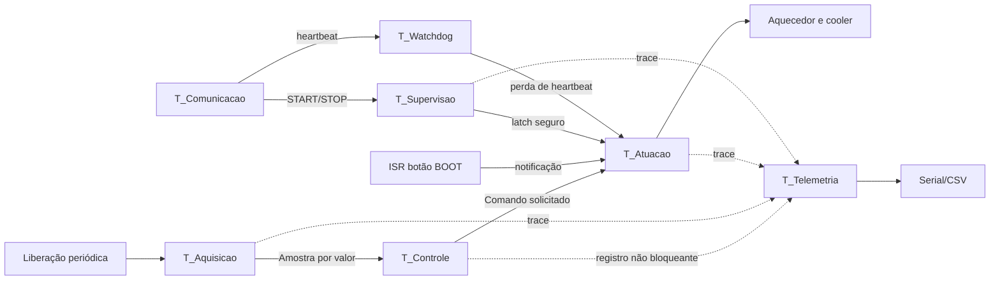

# Arquitetura de tempo real

## 1. Decisão arquitetural

A aplicação foi implementada sobre o FreeRTOS integrado ao ESP32. Aquisição,
controle, atuação, watchdog e supervisão executam no núcleo 1; comunicação e
telemetria executam no núcleo 0. Essa decisão mantém a transmissão serial fora
do caminho crítico e permite analisar o núcleo 1 por prioridade fixa.

O algoritmo de controle não foi fragmentado por operação matemática. Seus
estados formam uma unidade funcional pertencente exclusivamente a
`T_Controle`.



## 2. Conjunto de tarefas

Prioridades FreeRTOS maiores representam maior urgência. A tabela apresenta a
configuração final e os orçamentos usados na análise de resposta.

| Tarefa | Tipo | Ativação | Orçamento `Q` | Deadline | Prioridade | Núcleo | Responsabilidade |
|---|---|---:|---:|---:|---:|---:|---|
| `T_Atuacao` | esporádica | comando ou alarme | 0,270 ms | 20 ms | 8 | 1 | único proprietário dos PWMs e latch de segurança |
| `T_Watchdog` | periódica | 5 ms | 0,020 ms | 20 ms | 7 | 1 | detecção independente de perda de heartbeat |
| `T_Supervisao` | periódica e notificável | 500 ms ou evento | 82 ms | 500 ms | 6 | 1 | sensores, sobretemperatura, duração e eventos |
| `T_Controle` | sucessora esporádica | nova amostra | 0,600 ms | 100 ms | 5 | 1 | algoritmo completo do PRJ2 e publicação do comando |
| `T_Aquisicao` | periódica | 5,715 s | 330 ms | 600 ms | 4 | 1 | leitura filtrada de `Tp` e `Ta` e snapshot coerente |
| `T_Comunicacao` | aperiódica | evento UART | 5 ms | 100 ms | 3 | 0 | recepção e validação de comandos |
| `T_Telemetria` | aperiódica | item em fila | 25 ms | 5,715 s, suave | 2 | 0 | formatação e transmissão serial |
| `T_Carga` | periódica de teste | configurável | configurável | configurável | 1 ou 5 | 1 | interferência calibrada, ausente no nominal |

O orçamento da aquisição inclui as conversões ADC e margem sobre o maior
envelope ajustado. A supervisão usa 82 ms de demanda e até 325 ms de bloqueio
no mutex do ADC. A utilização nominal baseada em `Q`, sem `T_Carga`, é:

```text
U = 0,22590
```

Esse valor de 22,590% é uma verificação de plausibilidade. Bloqueio e
interferência são tratados pela análise de resposta documentada em
[`ANALISE_WCET_WCRT.md`](ANALISE_WCET_WCRT.md).

### 2.1 T_Atuacao

- Bloqueia aguardando comandos ou notificações.
- Verifica primeiro o latch de segurança.
- Em estado seguro, aplica `U=0` e `W=0`, independentemente do comando de
  controle pendente.
- Registra o instante real de escrita dos PWMs, encerrando a medição fim a fim.
- Não executa serial nem cálculos do controlador.

### 2.2 T_Supervisao

- Usa `vTaskDelayUntil` para preservar periodicidade.
- Realiza leitura de `Tp` com 64 conversões para detecção de
  sobretemperatura, mantendo o corte imediato em 60 °C.
- Verifica validade do último snapshot e duração máxima do ensaio.
- Recebe `STOP` e eventos de falha por notificação ou fila.
- Aciona o latch e desperta imediatamente `T_Atuacao` quando necessário.

O período de 500 ms foi escolhido porque a planta é lenta e porque a leitura
principal mantém o ADC ocupado por intervalos longos. A análise inclui esse
bloqueio separadamente da demanda de CPU.

### 2.3 T_Watchdog

- Executa periodicamente a cada 5 ms no núcleo crítico.
- Verifica o vencimento do heartbeat sem depender da supervisão.
- Notifica diretamente `T_Atuacao` quando o prazo de 15 s expira.
- Possui orçamento de 20 us e WCRT de tarefa de 0,290 ms; somada a fase de
  varredura, a detecção é limitada a 5,290 ms.

### 2.4 T_Aquisicao

- É a origem da transação periódica de controle.
- Mantém liberação absoluta, evitando deriva acumulada.
- Adquire `Tp` e `Ta` com o mesmo método da baseline inicialmente.
- Produz uma estrutura imutável contendo valores, sequência e timestamps.
- Envia a amostra por uma fila de comprimento um; uma amostra antiga nunca
  pode substituir silenciosamente uma transação ainda não concluída.

### 2.5 T_Controle

- É liberada somente por uma amostra completa.
- É a única proprietária de estados de controladores e observadores.
- Calcula referência, cooler, modo, ponderação, candidatos, saturação,
  anti-windup e evolução dos estados na ordem validada no PRJ2.
- Publica o comando para `T_Atuacao` e um registro por valor para telemetria.
- Não usa `Serial.printf` e não aguarda espaço de fila de telemetria.

### 2.6 T_Comunicacao e T_Telemetria

As duas tarefas ficam fora do núcleo crítico. Comunicação transforma eventos
UART em mensagens internas pequenas; telemetria consome cópias prontas e pode
descartar registros quando sua fila estiver cheia. Os descartes são uma
métrica, não uma falha silenciosa.

### 2.7 T_Carga

Existe apenas para experimentos de interferência. Executa trabalho calibrado,
sem acessar controle, ADC ou atuadores. O cenário deve registrar período,
prioridade e orçamento configurados. No ensaio nominal permanece suspensa.

## 3. Interrupções e eventos aperiódicos

### 3.1 Interrupção de hardware

O botão `BOOT` da placa, ligado ao GPIO 0, é usado como entrada de emergência
sem exigir componente externo. Após a inicialização, o pino é configurado com
pull-up e interrupção por borda de descida.

A ISR, mantida em IRAM, limita-se a:

1. registrar uma flag atômica;
2. notificar `T_Atuacao` com a variante `FromISR`;
3. solicitar troca de contexto se uma tarefa mais prioritária for liberada.

Debounce e registro detalhado são feitos fora da ISR. O GPIO 0 é um pino de
strapping; portanto, o botão não deve permanecer pressionado durante reset ou
gravação.

### 3.2 Evento de software

O comando serial `STOP` constitui a fonte aperiódica de software. Ele é
recebido por `T_Comunicacao`, validado e encaminhado à supervisão, que aciona
o mesmo caminho latched de desligamento. Sua latência foi medida
separadamente da interrupção física.

## 4. Precedências

```text
liberação periódica
      -> aquisição completa
      -> controle da mesma sequência
      -> atuação correspondente
      -> telemetria eventual
```

Não é permitido iniciar o job de controle `k+1` enquanto a transação `k`
ainda aguarda atuação. Uma ocorrência dessa condição é falha temporal e deve
ser registrada, não mascarada por sobrescrita de fila.

## 5. Escalonamento e bloqueio

No núcleo crítico é usado escalonamento preemptivo por prioridade fixa. A
atribuição segue deadlines locais e precedência: atuação e segurança têm
prioridade sobre controle; controle liberado preempta a próxima aquisição.

O principal bloqueio conhecido é o mutex do ADC. `T_Supervisao` pode aguardar
uma seção de leitura iniciada por `T_Aquisicao`; por isso o mutex deve usar
herança de prioridade e sua duração foi medida. Nenhum mutex é mantido
durante serial, espera de fila ou cálculo do controlador.

## 6. Distribuição de propriedade

| Recurso ou estado | Proprietário | Consumidores |
|---|---|---|
| estados dos controladores e observadores | `T_Controle` | nenhum acesso direto |
| PWM físico | `T_Atuacao` | atuadores |
| latch de segurança | `T_Atuacao`/flag atômica | supervisão e controle consultam estado |
| ADC | seção protegida por mutex | aquisição e supervisão |
| amostra térmica | mensagem por valor | controle |
| heartbeat e comandos | comunicação | supervisão por mensagem |
| registros e traces | produtores por cópia | telemetria |

## 7. Política de falhas

Falhas de sensor, sobretemperatura, emergência, timeout de comunicação,
inconsistência de sequência ou configuração inválida levam ao estado seguro.
Perda de telemetria não desliga a planta se o heartbeat continuar válido, mas
é sinalizada e contabilizada. Uma perda de deadline crítica pode ser
configurada para desligamento no ensaio físico e apenas registro no modo de
simulação.
